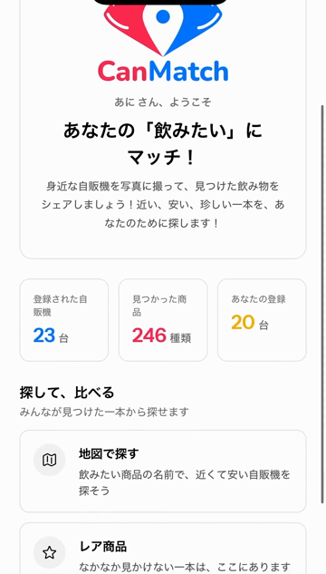
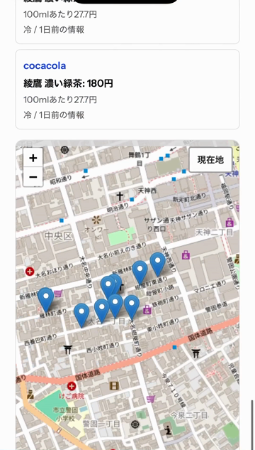
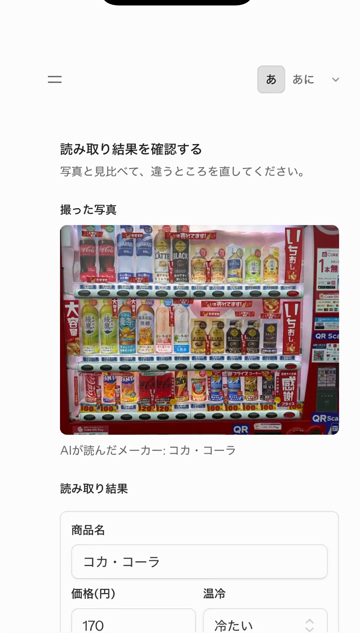
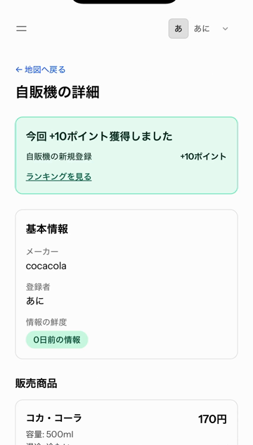
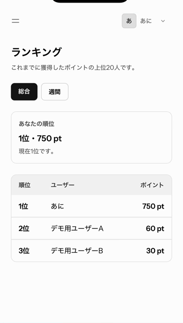
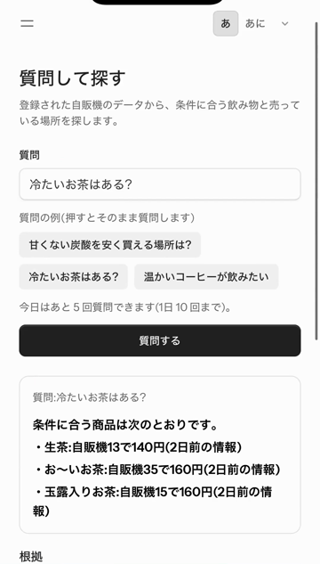

# CanMatch

**あなたの「飲みたい」にマッチ！** ― 写真で集めて、みんなで探す自販機マップ

身近な自販機を写真に撮るだけで、AI が商品と価格を読み取ります。みんなで登録した情報から、近い・安い・珍しい一本を探せます。

NEXT ENGINEER CATAPULT 2026 Phase02 Dチーム(安 揮星・大石 蒼稀・田中 玲羽・西井 彩)

## きっかけ

「ドクターペッパーって、どこの自販機に売ってるの?」という雑談から始まりました。調べると、同じ商品の地図を作っている人や似たサービスがすでにありました。そこで CanMatch は、探すだけでなく**見つけて登録するのが楽しいゲーム性**で差をつけ、使う人が自分から登録することでデータが集まる仕組みにしました。

## 二本の柱

| 集める(ゲーミフィケーション) | 探す(検索サービス) |
|---|---|
| 自販機の写真を撮るだけで、AI が商品名・価格・温冷を読み取る | 商品名で地図を検索し、安い順・100mlあたりの値段で比べる |
| AI の結果は下書き。人が確認・修正してから登録する | 情報の新しさ(何日前の情報か)が一目で分かる |
| 登録でポイント、珍しい商品の発見でボーナス、ランキングで競う | 「冷たいお茶はある?」のように言葉で質問しても探せる(RAG) |

## 主な機能

| 画面 | 内容 |
|---|---|
| ダッシュボード | 登録された自販機・見つかった商品・自分の登録の数と、各機能への入口 |
| 地図 | 自販機のピン、商品名での絞り込み、安い順の一覧(最安・100mlあたり・情報の鮮度) |
| 自販機の詳細 | 販売商品と価格・温冷・容量、情報の鮮度、場所 |
| 投稿 | 撮影 → AI 読み取り → 確認・修正(商品マスタとの照合) → 登録。現在地が取れないときは地図で位置を指定 |
| レア商品 | 販売している自販機が3台以下の商品の一覧 |
| ランキング | 総合・週間のポイント順位と、自分の順位・上位との差 |
| 質問 | 登録データだけを根拠に、AI が条件に合う自販機と価格を答える(1人1日10回まで) |

## 使用技術

| 分類 | 技術 |
|---|---|
| アプリ | Laravel 12、Livewire(Volt)、Flux UI、Tailwind CSS、Leaflet + OpenStreetMap |
| AI | Gemini 3.5 Flash-Lite(写真の読み取り)、Cloudflare Workers AI(bge-m3 による埋め込み・回答文の生成)、Vectorize(類似商品の検索)、AI Gateway(呼び出しの記録) |
| データ・公開 | MySQL 8、Cloudflare R2(写真の非公開保存)、Laravel Cloud(東京リージョン) |
| 開発 | Docker / Laravel Sail、GitHub Actions(PHPUnit・Pint)、Claude Code などの AI コーディング支援 |

構成図とデータの流れは [docs/architecture.md](docs/architecture.md)、テーブルと JSON の形は [docs/data-contract.md](docs/data-contract.md)、質問機能(RAG)は [docs/rag-design.md](docs/rag-design.md) を参照してください。

## AI 読み取りの精度

評価用の写真10枚と正解ファイル([evals/](evals/))を使い、`php artisan eval:reader` で正解率を測っています(2026-10-22、gemini-3.5-flash-lite / 指示文 vending_read_v1)。

| | 厳しめ | ゆるめ |
|---|---|---|
| 商品名 | 57% | 78% |
| 価格 | 50% | 68% |
| 温冷 | 55% | 77% |
| すべて一致 | 50% | 68% |

正解率が100%ではないため、AI の結果は必ず確認画面で人が直してから登録する設計にしています。

## データの扱い

- **出どころ:** 自販機と価格は、利用者が撮影・確認して登録したもの。商品マスタの初期データは、各メーカーの公式情報をもとに作成([docs/product-master-sources.md](docs/product-master-sources.md))
- **品質の確認:** AI の読み取りは下書きとし、商品マスタとの照合(完全一致は自動、複数・部分一致は候補から選択)と人の確認を経て登録する。同じ商品・温冷の重複は登録時に拒否する
- **新しさ:** 価格ごとに確認日時を記録し、「何日前の情報か」を表示する。撮り直しによる更新、撤去報告での非表示は今後の課題
- **写真:** 非公開で保存し、表示は10分だけ有効な URL を使う。他の利用者には公開しない
- **秘密情報:** API キーなどは環境変数だけに置き、リポジトリやログに残さない

## 画面

<table>
  <tr>
    <td align="center"><br>ダッシュボード</td>
    <td align="center"><br>地図で商品を検索</td>
    <td align="center"><br>AI の読み取り結果を確認</td>
  </tr>
  <tr>
    <td align="center"><br>登録すると +10ポイント</td>
    <td align="center"><br>ランキング</td>
    <td align="center"><br>言葉で質問して探す</td>
  </tr>
</table>

※ランキングの「デモ用ユーザー」は、表示を確かめるために作ったアカウントです。

## 今後の展望

- **RAG の回答精度を上げる:** 公開 API などから商品情報を集め、AI が表記ゆれを直して投稿された商品と結びつけ、甘さ・炭酸・カフェインなどを補う。質問を条件に分解して絞り込み、評価セットで改善を測る
- **ポイント制度の改良:** 遡及した発見ボーナスの通知、更新ポイントと連続登録の制限、不正な加点の防止
- **情報の新しさと信頼性:** 撮り直しでの更新、撤去報告で地図から外す、ボット対策(Turnstile)

## 役割分担

| 担当 | 主な内容 |
|---|---|
| 大石 蒼稀 | 投稿の流れ(写真投稿・位置情報・確認画面・商品の照合・登録) |
| 田中 玲羽 | DB 設計とモデル、開発環境・CI・作業ルール、地図・詳細・検索・レア商品・ランキング・ポイント |
| 安 揮星 | AI の読み取りと精度評価、質問機能(RAG)、写真の保存(R2)、公開環境(Laravel Cloud)、仕様書・構成図 |

## 開発環境の起動

開発環境にはLaravel Sail（Docker）を使用します。WindowsではDocker DesktopとWSL2を用意し、リポジトリはWSLのホームディレクトリ配下へcloneしてください。Cドライブを`/mnt/c`経由で使う配置は、ファイルアクセスが遅くなるため避けます。

### 初回セットアップ

リポジトリをcloneしたディレクトリで、次の順に実行します。

```bash
cp .env.example .env
```

`.env.example`にはSailのMySQL接続設定が入っています。コピー後、次を実行します。

```bash
docker run --rm \
    -u "$(id -u):$(id -g)" \
    -v "$(pwd):/var/www/html" \
    -w /var/www/html \
    laravelsail/php85-composer:latest \
    composer install --ignore-platform-reqs

./vendor/bin/sail up -d
./vendor/bin/sail artisan key:generate
./vendor/bin/sail artisan migrate
./vendor/bin/sail artisan db:seed --class=ProductSeeder
./vendor/bin/sail npm install
./vendor/bin/sail npm run dev
```

`sail npm run dev`は開発中、そのまま起動しておきます。別のターミナルで次を確認してください。

- アプリ: <http://localhost>
- phpMyAdmin: <http://localhost:8080>

phpMyAdminには`.env`の`DB_USERNAME`と`DB_PASSWORD`でログインします。APIキーなどの秘密情報を設定した`.env`はコミットしません。

### AI と写真保存の設定(必要な人だけ)

画面の表示や地図はそのまま動きます。写真の読み取りや質問機能を手元で試すときは、`.env`に次を設定します。値はチャットやIssueに貼らないでください。

| 機能 | 設定する項目 |
|---|---|
| 写真の読み取り(Gemini) | `GEMINI_API_KEY`(各自が Google AI Studio で取得)。モデルと指示文は`.env.example`の初期値のまま |
| 質問機能(RAG) | `CLOUDFLARE_ACCOUNT_ID`、`CLOUDFLARE_API_TOKEN`。索引は開発用の`CF_VECTORIZE_INDEX=canmatch-products` |
| 写真を R2 に保存 | `PHOTOS_DISK=r2`と`R2_*`。未設定ならローカル(`PHOTOS_DISK=local`)に保存 |

質問機能を使う前に、商品を検索用の索引へ登録します。

```bash
./vendor/bin/sail artisan rag:reindex
```

### よく使うコマンド

| コマンド | 内容 |
|---|---|
| `sail artisan test` | 全テスト(外部サービスは偽の応答に差し替え) |
| `sail pint --test --dirty` | 変更したファイルの書き方の確認 |
| `sail artisan rag:reindex` | 商品を質問機能の索引へ登録し直す |
| `sail artisan rag:evidence "質問"` | 質問に対する根拠の行を確認する(回答は生成しない) |
| `sail artisan eval:reader` | AI 読み取りの正解率を評価用の写真で測る |
| `sail artisan points:backfill-registrations` | 既存の自販機に登録ポイントを補完する(既定はプレビューのみ、`--apply`で実行) |

### 2回目以降

```bash
./vendor/bin/sail up -d
./vendor/bin/sail npm run dev
```

終了するときは、開発サーバーを`Ctrl+C`で止めてから次を実行します。

```bash
./vendor/bin/sail down
```

依存パッケージやマイグレーションが追加された場合は、必要に応じて次も実行します。

```bash
./vendor/bin/sail composer install
./vendor/bin/sail npm install
./vendor/bin/sail artisan migrate
```

## 開発ルール

### ブランチ

- `main`へ直接pushしない。
- 作業前に最新の`main`を取り込んでから、Issueごとのブランチを作る。
- 機能追加は`feature/<Issue番号>-<短い説明>`、不具合修正は`fix/<Issue番号>-<短い説明>`とする。
- 例: `feature/24-point-logs`、`fix/28-nav-structure`

### Issueとプルリクエスト

- 原則として、1つのIssueに対して1つの小さなプルリクエストを作る。
- 依存するプルリクエストが未マージの場合は、変更を重ねず、依存関係と取り込み順を本文に書く。
- Issueの完了条件をすべて満たす場合だけ、本文に`Closes #Issue番号`を書く。
- Issueの一部だけを扱う場合や、後続作業が残る場合は`Refs #Issue番号`と書く。
- GitHub Actionsの成功と1人以上のレビューを確認してからマージする。
- Actionsが使えない場合でも、実行した確認と結果をプルリクエスト本文に残す。

### 変更内容の確認

- AIが生成したコードも、プルリクエストを出す本人が差分を読み、動作とテスト結果を確認する。
- 関係のない整形やリファクタリングを同じプルリクエストへ混ぜない。
- 未確認事項、実機でだけ確認できる項目、後続Issueへ残す項目を明記する。
- ダミーデータを使う場合は開発用と明記し、本番用の実データへ差し替えられる状態にする。

### ラベルとマイルストーン

- Issueには作業内容に対応するラベルを付ける。使用する分類は`team`、`setup`、`db`、`ui`、`map`、`post`、`ai`、`search`、`ranking`、`rag`、`release`とする。
- 計画上のマイルストーンは`M0`〜`M8`と`MT`を使用する。
- ラベルやマイルストーンを追加・変更する場合は、既存Issueへの影響を確認してチームへ共有する。

### 変更してはいけないもの

- `.env`、APIキー、パスワードなどの秘密情報をコミットしない。
- 本番データを開発作業で変更・削除しない。
- `compose.yaml`の変更は全員の開発環境に影響するため、変更理由と移行手順をプルリクエストに書く。

AI を使った作業のルールと確認コマンドは [AGENTS.md](AGENTS.md) にまとめています。

## デプロイ

公開環境、デプロイ(公開)・マイグレーション前のバックアップ・元に戻す手順は [docs/deploy.md](docs/deploy.md) にまとめています。公開 URL はチーム内でだけ共有します。
