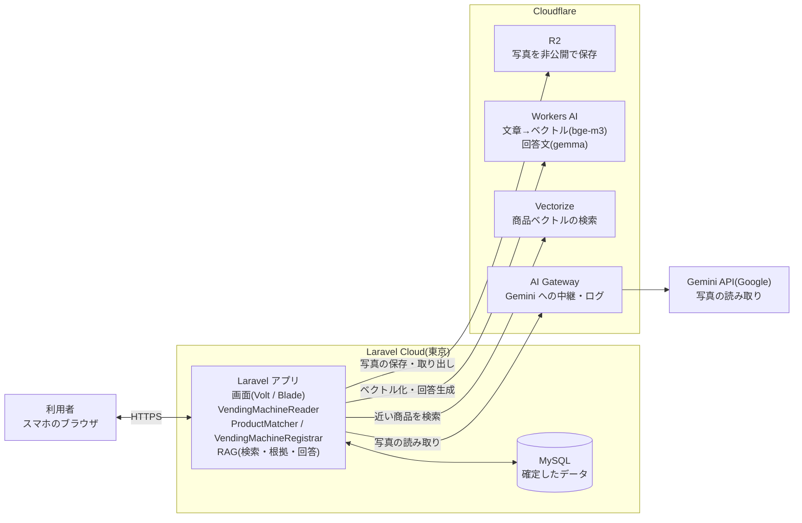
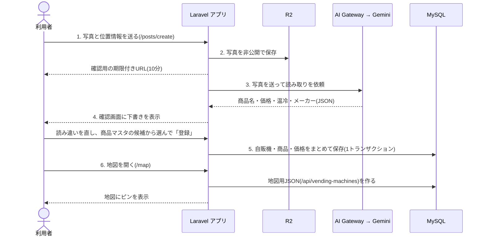
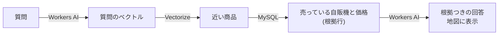

# CanMatch アーキテクチャ概要

更新日: 2026-10-24（日本時間）／確認した main: `bfd364c`

CanMatch は、自販機の写真から商品と価格を読み取り、人が確認してから登録し、地図・検索・集計・質問応答(RAG)で使う Web アプリケーションです。

この文書は、初めて見た人が「写真1枚がどこを通って地図に出るか」を説明できることを目的に、構成・データの流れ・データの置き場所・開発環境と本番環境の違いをまとめます(Issue #6)。

関連文書:
- [共通データ仕様](data-contract.md): テーブル、AI読み取りJSON、地図用JSONの形
- [RAG詳細設計](rag-design.md): 質問応答の検索条件・根拠行・回答の作り方
- [公開環境とデプロイ手順](deploy.md): 本番の設定、Deploy、バックアップ

## 1. 構成図

| 部品 | 役割 | 主な設定 |
|---|---|---|
| ブラウザ | 利用者が使う画面。スマホで撮影・位置情報の取得を行う | ― |
| Laravel アプリ | 画面、入力の検証、AI の呼び出し、登録、集計のすべてを担う | ― |
| MySQL | 確定したデータ(自販機・商品・価格・ポイント)を保存する | `DB_*` |
| R2 | 投稿写真を非公開で保存する。表示は期限付きURL | `PHOTOS_DISK`、`R2_*` |
| AI Gateway | アプリから Gemini への呼び出しを中継し、回数・所要時間・成否・推定費用を記録する | `GEMINI_BASE_URL` |
| Gemini API | 写真から商品名・価格・温冷・メーカーを読み取る(`gemini-3.5-flash-lite`、指示文 `vending_read_v1`) | `GEMINI_*` |
| Workers AI | 商品の文章と質問をベクトルにする(`@cf/baai/bge-m3`)。質問への回答文を作る | `CF_*` |
| Vectorize | 商品ベクトルを保存し、質問に近い商品を探す | `CF_VECTORIZE_INDEX` |

AI Gateway を通すかどうかは `GEMINI_BASE_URL` で切り替える。本番は Gateway 経由(2026-10-24 確認)で、呼び出しの記録は Cloudflare ダッシュボード → AI → AI Gateway → `canmatch` → Logs で見られる。アプリは応答ヘッダーのログID(`cf-aig-log-id`)を読み取り結果に含めるが、DB には保存していない。

## 2. データの流れ: 写真1枚が地図に出るまで

1. **撮影・送信**: 投稿画面(Volt `posts.create`)で写真を選び、ブラウザで取得した位置情報と一緒に送る。
2. **写真を保存**: `PHOTOS_DISK` のディスク(本番は R2)に `photos/年/月/` で保存する。確認画面では10分だけ有効なURLで表示する。「撮り直す」と保存した写真を削除する。
3. **AI が読み取る**: `VendingMachineReader` が写真を Gemini へ送り、返ってきた JSON を正規化する。読めない値は推測で埋めず null にする。自販機でない写真や、上限超過・タイムアウトは利用者向けのエラーにする。
4. **人が確認・修正**: AI の結果は下書きとして扱う。利用者が商品名・価格・温冷を直し、`ProductMatcher` が商品マスタの候補を示す(完全一致1件なら自動で紐づけ、複数なら選ばせる)。
5. **登録**: `VendingMachineRegistrar` が自販機・商品・価格を1つのトランザクションで保存する。同じ商品・温冷の重複があれば全体を取り消す。商品マスタにない商品は新しく作る(容量は任意)。
6. **地図・検索・集計**: 登録されたデータは、地図のピン(`/map`)、商品名での絞り込み、自販機の詳細(`/vending-machines/{id}`)、レア商品(`/rare-products`)、総合ランキング(`/ranking`)に使われる。

### 質問応答(RAG)の流れ

- 商品ベクトルは `php artisan rag:reindex` で商品マスタ全体から作る(`ProductIndexer`)。ベクトルIDは商品ID。
- 投稿で新しく作られた商品は、自動では Vectorize に登録されない。商品が増えたら `rag:reindex` を実行し直す。
- 回答文は AI の文章をそのまま使わず、AI が選んだ根拠(自販機ID・商品ID・価格)が実在するかをサーバーで確かめてから組み立てる。詳しくは [RAG詳細設計](rag-design.md)。
- 質問画面(`/ask`)、根拠の取得、1日の質問上限は PR #132〜#134 でレビュー中。

## 3. どこに何を残すか

| データ | 置き場所 | 規則 |
|---|---|---|
| 写真 | R2(開発はローカルも可) | 非公開で保存し、表示は期限付きURL。DB には相対パス(`photo_path`)だけを持つ。写真の公開可否は #69 で検討 |
| AI の生の応答 | アプリには保存しない | 読み取り結果は確認画面の下書きにだけ使う。呼び出しの記録は AI Gateway のログで確認できる。永続化の方法は #08 で検討 |
| 確定したデータ | MySQL | `vending_machines`、`products`、`machine_products`、`point_logs` など。日時は UTC で保存し、表示は日本時間 |
| 商品のベクトル | Vectorize | 元データは MySQL の商品マスタ。消えても `rag:reindex` で作り直せる |
| API キーなどの秘密 | 環境変数 | `.env` と Laravel Cloud の環境変数だけに置く。リポジトリ・ログ・チャットに残さない |

AI Gateway のログには、設定によっては送信した写真と応答の本文まで残る。本文を残す必要がなければ Gateway の設定で保存をオフにする。

## 4. 開発環境と本番環境の違い

同じコードを、環境変数だけ変えて動かす。

| 項目 | 開発環境 | 本番環境 |
|---|---|---|
| 動かす場所 | 各自の PC の Docker 上の Laravel Sail | Laravel Cloud(東京リージョン) |
| データベース | Sail の MySQL 8。中身は phpMyAdmin(`http://localhost:8080`)で確認 | Laravel MySQL。毎日自動バックアップ |
| 写真の保存先 | ローカル(`PHOTOS_DISK=local`)、または R2 の開発用バケット `canmatch-dev` | R2 の本番用バケット `canmatch-prod` |
| Gemini のキー | 各自が Google AI Studio で取得 | 本番専用のキー |
| Vectorize の索引 | `canmatch-products` | `canmatch-products-prod` |
| 反映のしかた | 自分のブランチで試す | main にマージ後、手動で Deploy(`migrate --force` が走る) |
| 初期データ | 開発用シーダー(ダミー)を使える | `--class=ProductSeeder` の商品マスタだけ。ダミーは入れない |

テスト(GitHub Actions)は SQLite のメモリ上の DB で動かし、Gemini・Workers AI・Vectorize・R2 は偽の応答や偽の保存先に差し替える。実サービスは呼ばない。

## 5. 主なコンポーネント

| クラス | 役割 |
|---|---|
| `App\Services\VendingMachineReader` | 写真を読み込んで Gemini へ送り、結果を正規化する。失敗は `AiReadFailedException` で種類(429・タイムアウト・JSON 解析失敗など)を分ける |
| `App\Services\ProductMatcher` | 商品名を正規化し、商品マスタの完全一致・部分一致の候補を返す |
| `App\Services\VendingMachineRegistrar` | 自販機・商品・価格をまとめて保存する。重複や不正な商品IDがあれば全体を取り消す |
| `App\Http\Controllers\Api\VendingMachineController` | 地図用JSON。商品名での絞り込みにも対応 |
| `App\Services\Rag\EmbeddingService` | Workers AI で文章をベクトルにする |
| `App\Services\Rag\VectorIndex` | Vectorize への登録・検索・削除 |
| `App\Services\Rag\ProductIndexer` | 全商品をベクトル化して Vectorize に登録する(`rag:reindex`) |
| `App\Services\Rag\AnswerGenerator` | 回答文を生成し、根拠(citations)が実在するかを検証して回答を組み立てる |

## 6. 実装状況

### main に統合済み
- 写真投稿 → AI 読み取り → 確認・修正 → 登録の一連の流れ
- 地図表示、商品名での絞り込み、価格順、100mlあたりの単価、情報の新しさ
- 自販機の詳細、レア商品、総合ランキング
- RAG の部品(`EmbeddingService`、`VectorIndex`、`ProductIndexer`、`AnswerGenerator`)と `rag:reindex`

### レビュー中・未実装
- 質問画面と、質問から回答までの統合処理(PR #132〜#134)
- ポイントの付与(#53〜#55)。付与されるまで総合ランキングは空になる
- 商品登録時の Vectorize への自動登録(現在は `rag:reindex` を手動実行)
- `question_logs` の正式スキーマ(PR #134)

### 未確定事項
- 写真の公開可否と保持期間(#69)
- AI の生の応答の永続化(#08)
- RAG の運用パラメータ(しきい値 0.45、topK 10)の最終評価
